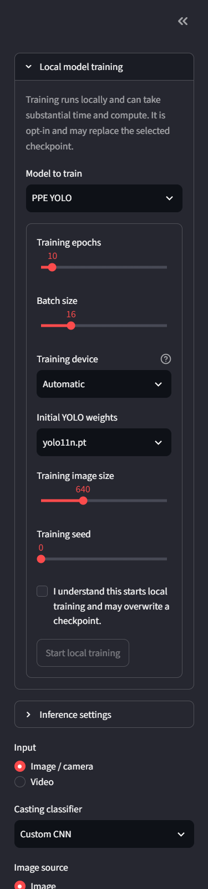
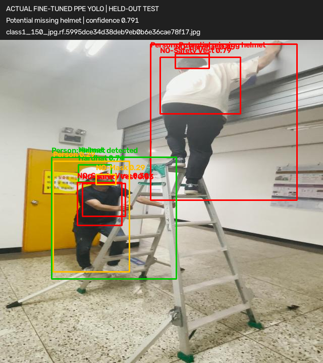
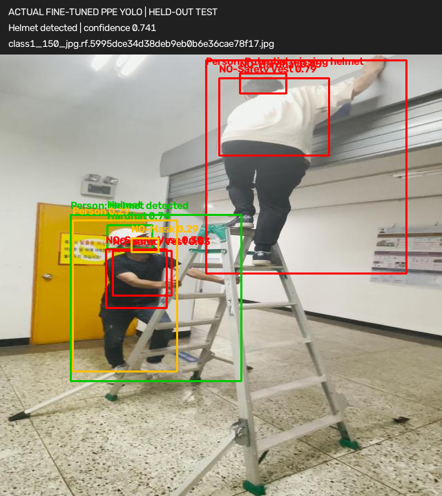

# FactoryVisionAI

An educational factory-inspection prototype with separate PPE and casting-quality
pipelines, a shared alert queue, and human review. Camera snapshots, still images,
and video uploads are supported by the Streamlit dashboard.

> **NOT A CERTIFIED INDUSTRIAL SAFETY SYSTEM.** This educational prototype is
> not certified, validated, or approved for workplace safety or product
> release. It must not be used as a safety control or as a substitute for
> qualified human inspection. All model outputs are suggestions that require
> independent review.

## Architecture

```text
Camera / image / video
        |
OpenCV decode, BGR frames, video frame sampling
        |
        +-- Safety: pretrained YOLO object detector
        |            + fine-tuned PPE YOLO detector (when its checkpoint exists)
        |
        +-- Quality: custom PyTorch CNN OR fine-tuned MobileNetV3-Small
        |
Decision engine -> PPE confidence-gated alerts + defect review alerts -> dashboard / CSV
```

The pretrained COCO detector is for general-object context; it does not identify
helmets. When the fine-tuned PPE checkpoint exists, the decision engine associates
each detected person/head with helmet detections in that worker's head region.
Workers with an associated helmet are annotated without a PPE alert; detected
people or heads without one are flagged as potential violations for human review.
Without that checkpoint, PPE compliance is reported as unavailable instead of
guessing from missing general-object detections. The fine-tuned PPE and selected
casting checkpoints are now installed locally. Casting predictions show clean
products as acceptable and flag defective predictions for manual inspection.

PPE alerts use the configured confidence threshold. A defective quality class
always enters the review queue, even at low confidence, so uncertain defects can
be resolved by an operator rather than silently discarded.

## Downloaded datasets

The required datasets have been downloaded and extracted under `datasets/raw/`.
To repeat the download, configure Kaggle API credentials and run:

```powershell
python scripts\download_datasets.py
```

The optional hard-hat extension is about 1.32 GB and is excluded by default:

```powershell
python scripts\download_datasets.py --include-hard-hat
```

### PPE detection

- [Construction Site Safety Image Dataset](https://www.kaggle.com/datasets/snehilsanyal/construction-site-safety-image-dataset-roboflow)
- Extracted at `datasets/raw/ppe/css-data/`.
- The archive contains `train`, `valid`, and `test` directories, each with
  `images/` and `labels/`. Its 10 classes are recorded in
  `configs/ppe_data.yaml`: `Hardhat`, `Mask`, `NO-Hardhat`, `NO-Mask`,
  `NO-Safety Vest`, `Person`, `Safety Cone`, `Safety Vest`, `machinery`, and
  `vehicle`.
- Extracted split counts are 2,605 training, 114 validation, and 82 test images;
  the corresponding YOLO label directories contain matching counts.
- Kaggle lists the dataset as CC BY 4.0. Attribute the original creators and
  review the linked dataset and included Roboflow attribution files before reuse.

### Casting quality

- [Real-Life Industrial Dataset of Casting Product](https://www.kaggle.com/datasets/ravirajsinh45/real-life-industrial-dataset-of-casting-product)
- The split-respecting images are under
  `datasets/raw/casting/casting_data/casting_data/{train,test}/{def_front,ok_front}/`.
  The archive also contains a separate, unsplit `casting_512x512` image set; the
  training script intentionally uses the provided train/test split.
- Kaggle lists the dataset as CC BY-NC-ND 4.0. It is non-commercial and has
  no-derivatives restrictions. Confirm that your intended training, model use,
  and any sharing comply with the dataset license and applicable permissions.

### Optional helmet dataset

- [Hard Hat Detection](https://www.kaggle.com/datasets/andrewmvd/hard-hat-detection)
- Kaggle lists CC0. It is not downloaded by default and is not required by the
  current training scripts.

Raw data and model checkpoints are excluded from version control by `.gitignore`.
Do not redistribute the datasets or trained weights without checking their
respective terms.

## License and citations

### Citing FactoryVisionAI

Citation metadata for this software is provided in
[CITATION.cff](./CITATION.cff), which GitHub uses to display a “Cite this
repository” option. Dataset and research citations are listed below.

### Dataset licenses and attribution

| Dataset | Attribution | License and reuse notes |
|---|---|---|
| [Construction Site Safety Image Dataset Roboflow](https://www.kaggle.com/datasets/snehilsanyal/construction-site-safety-image-dataset-roboflow) | Snehil Sanyal; dataset sourced from [Roboflow Universe Projects](https://universe.roboflow.com/roboflow-universe-projects/construction-site-safety) | [CC BY 4.0](https://creativecommons.org/licenses/by/4.0/). Attribute the dataset/Roboflow source and preserve required notices. |
| [Real-Life Industrial Dataset of Casting Product](https://www.kaggle.com/datasets/ravirajsinh45/real-life-industrial-dataset-of-casting-product) | Ravirajsinh Dabhi; dataset acknowledgements include PILOT TECHNOCAST | [CC BY-NC-ND 4.0](https://creativecommons.org/licenses/by-nc-nd/4.0/). Non-commercial and no-derivatives terms apply; review the license before training, modifying, or distributing dataset-derived material, checkpoints, or results. |
| [Safety Helmet Detection](https://www.kaggle.com/datasets/andrewmvd/hard-hat-detection) (optional; not used in current training) | Larxel / MakeML | Kaggle lists [CC0 1.0 Public Domain](https://creativecommons.org/publicdomain/zero/1.0/). |

The dataset cards and bundled attribution files are authoritative for current
terms. Check each source again before reuse or distribution; dataset licenses do
not automatically grant rights to trained weights or this project's source code.

### References

1. Sanyal, S. (2023). *Construction Site Safety Image Dataset Roboflow*.
   Kaggle Dataset, version 3. Dataset card requests citation of the Roboflow
   Universe source. [Dataset](https://www.kaggle.com/datasets/snehilsanyal/construction-site-safety-image-dataset-roboflow) ·
   [Roboflow citation/source](https://universe.roboflow.com/roboflow-universe-projects/construction-site-safety).
2. Dabhi, R. (2020). *Real-Life Industrial Dataset of Casting Product*.
   Kaggle Dataset, version 2. Dataset acknowledgement: PILOT TECHNOCAST,
   Shapar, Rajkot. [Dataset](https://www.kaggle.com/datasets/ravirajsinh45/real-life-industrial-dataset-of-casting-product).
3. Howard, A. et al. (2019). *Searching for MobileNetV3*. Proceedings of the
   IEEE/CVF International Conference on Computer Vision (ICCV), 1314–1324.
   [DOI: 10.1109/ICCV.2019.00140](https://doi.org/10.1109/ICCV.2019.00140).
4. Ultralytics. *Ultralytics YOLO documentation and software*.
   [Documentation](https://docs.ultralytics.com/).

### Project source license

FactoryVisionAI's project source and documentation are licensed under the
[MIT License](./LICENSE). This license does not apply to datasets, trained
checkpoints, pretrained weights, or third-party dependencies; those materials
have separate terms that must be reviewed before use or distribution. See
[CONTRIBUTING.md](./CONTRIBUTING.md) for contribution guidelines.

## Setup

Use Python 3.10+ and install the dependencies in the active environment:

```powershell
python -m pip install -r requirements.txt
```

Open the dashboard from the project directory:

```powershell
streamlit run app.py
```

The first safety inference downloads Ultralytics' `yolo11n.pt` general-object
weights if they are not already cached. A PPE checkpoint is expected at
`checkpoints/ppe_yolo.pt`; quality checkpoints are expected at
`checkpoints/casting_cnn.pth` or `checkpoints/casting_mobilenet_v3_small.pth`.

## Interactive dashboard and adjustable training

The sidebar exposes inference sliders for detector confidence, inference image
size, and video frame sampling. Its **Local model training** panel provides
explicit, adjustable controls for PPE YOLO, the custom CNN, and MobileNetV3-Small:

- Training epochs and batch size are adjustable for each model.
- PPE training exposes initial YOLO weights, image size, seed, and device.
- Quality training exposes learning rate, seed, and device.
- Training starts only after checking the confirmation box and submitting the
  form. It runs locally, streams logs into the dashboard, and may overwrite the
  selected checkpoint. Start with small settings for a smoke test; full training
  may take substantial time and compute.
- After successful training, the app reloads the updated checkpoint. The
  dashboard does not start Kaggle training; use `scripts/deploy_kaggle.py` for
  the Kaggle workflow.

CUDA selection reports an error if no CUDA-capable device is available rather
than silently switching devices. Adjusting thresholds or training parameters
does not validate or certify model performance.

### Dashboard and prediction examples

The local dashboard exposes adjustable training parameters. This actual capture
shows the controls without starting a training run:



The following actual held-out PPE predictions use the Construction Site Safety
Image Dataset by Snehil Sanyal, sourced from Roboflow Universe, under CC BY 4.0.
See the dataset attribution and license above. Model annotations are screening
outputs and may be false positives; they are not ground-truth determinations.

| PPE detection and human-review alert | Helmet detected; no PPE alert for the associated worker |
|---|---|
|  |  |

## Train on Kaggle and import the best models

The Kaggle training entry point is
[`scripts/kaggle_train.py`](./scripts/kaggle_train.py). It first evaluates
pretrained YOLO person detection on the PPE test images without fine-tuning and
saves up to 12 annotated examples. It then fine-tunes YOLO on the PPE annotations,
trains both casting classifiers, evaluates on held-out test splits, and chooses
the quality checkpoint with the highest validation macro-F1.

Exact duplicate casting images across the provided train/test splits are detected
by SHA-256. The test copy is retained and the matching training copy is excluded
from both casting models; excluded paths and effective split counts are recorded
in `dataset_inspection.json`. Images duplicated within one split or carrying
conflicting labels are rejected.

All output is written to `/kaggle/working/factoryvision_artifacts/`: captured
console and application logs, PPE YOLO runs and `results.csv`, casting epoch
histories, dataset inspection/class counts, baseline sample predictions, metrics,
and checkpoints. Kaggle dataset inputs are read-only and remain attached as
notebook inputs; the script does not copy the full raw datasets into outputs.

1. Review the casting dataset's CC BY-NC-ND terms before training or sharing.
   The workflow attaches both datasets as Kaggle notebook inputs and enables
   Internet and a T4 GPU.
2. Create the local credential file and add your Kaggle API token there:

   ```powershell
   if (!(Test-Path .env)) { Copy-Item .env.example .env }
   notepad .env
   ```

   Set `KAGGLE_API_TOKEN` in `.env`; keep the file local and never paste its
   contents into chat or upload it to Kaggle. `.env` is ignored by Git.
3. Ensure the active local Python environment has the project dependencies,
   including PyTorch, and the Kaggle CLI is available. Then run:

   ```powershell
   python scripts\deploy_kaggle.py
   ```

   The script checks local import dependencies before consuming GPU time, backs
   up the existing Kaggle notebook, uploads the generated training notebook,
   waits for completion, downloads its output bundle, verifies it, and imports
   the PPE checkpoint and validation-selected casting checkpoint under
   `checkpoints/`. Training defaults to 15 casting epochs and 30 PPE epochs;
   override them with `--epochs` and `--ppe-epochs`.
4. The original notebook backup, downloaded bundle, logs, metrics, and other
   Kaggle outputs are kept under `runs/kaggle/<timestamp>/`. Kaggle writes run
   outputs to notebook outputs rather than directly into the editor URL. Use
   `--no-run` to upload a notebook version without starting GPU training.

The pretrained YOLO baseline compares COCO `person` detections with `Person`
annotations in the held-out PPE test split at IoU 0.5; it measures person
detection, not PPE compliance. Casting precision, recall, F1, confusion matrices,
and inference latency are recorded per model. The quality winner is selected
using validation macro-F1, not test metrics. Dataset split and PPE class counts
are recorded in `dataset_inspection.json`.

## Submission deliverables and live demo

The locally generated engineering report, casting evaluation outputs, webcam
demo, and detailed model metadata remain in `reports/` and are not included in
this source repository. This avoids redistributing casting-dataset-derived
material under its CC BY-NC-ND terms or publishing webcam footage that may show
identifiable surroundings. Full Kaggle logs, epoch histories, evaluation plots,
and the verified model ZIP remain in the ignored local `runs/kaggle/` archive;
trained checkpoints remain in the ignored local `checkpoints/` folder. Review
dataset licenses and privacy before sharing those local artifacts.

To regenerate the report and actual predictions from the archived Kaggle run:

```powershell
python -m scripts.prepare_deliverables
```

This also regenerates `notebooks/factoryvisionai.ipynb` from the current
`scripts/kaggle_train.py` source and preserves the Kaggle kernel metadata beside
it. The notebook runs the configured 15 casting and 30 PPE epochs; it is a
reproducibility source, while the report's metrics and checkpoints refer to the
archived completed run. That run did not capture Kaggle package versions;
future runs record them in `runtime_metadata.json`.

A short real webcam clip processed by the dashboard is saved locally under
`reports/live_demo/`, with the sampled-frame alert CSV and a prediction-frame
capture. The clip is local demonstration evidence and may contain identifiable
surroundings; it is not included in this repository.

The CPU benchmark is measured at report-generation time and records local
hardware/software details. It is not a real-time guarantee or a Kaggle GPU
benchmark.

For a live dashboard demonstration, start Streamlit, select the image/camera or
video input mode, upload/capture a sample, inspect annotations and alerts, set a
review decision, and use **Download alert log** to export the CSV. Choose
**PPE only (no casting)** when the input is not a casting product; this avoids
presenting an unrelated casting prediction for a safety-camera frame:

```powershell
streamlit run app.py
```

## Local training scripts (not run)

Training requires an explicit confirmation flag:

```powershell
python scripts\train_safety.py --confirm-training --epochs 30
python -m scripts.train_quality --architecture cnn --confirm-training --epochs 10
python -m scripts.train_quality --architecture mobilenet_v3_small --confirm-training --epochs 10
```

The safety script fine-tunes `yolo11n.pt` on the local YOLO dataset and saves
`checkpoints/ppe_yolo.pt`. The quality script uses the provided casting train/test
split, creates a seeded validation subset from training data, and saves the best
validation checkpoint. MobileNetV3-Small starts from ImageNet weights for transfer
learning. Do not start either script until the dataset license and compute
requirements have been reviewed.

## Edge export (after training)

MobileNetV3-Small is the lightweight transfer-learning option. To create a
CPU-oriented TorchScript export with dynamic quantization of linear layers:

```powershell
python -m scripts.export_edge --model MobileNetV3-Small
```

The export script requires an existing quality checkpoint and does not train a
model. Benchmark exported outputs and latency on the target device before use.

## Prototype limitations

Alerts are confidence-filtered suggestions and need human confirmation. The
prototype does not enforce PPE policy, establish worker identity, or make
automated product-release decisions. Validate models on representative,
independently reviewed factory data before operational use.
